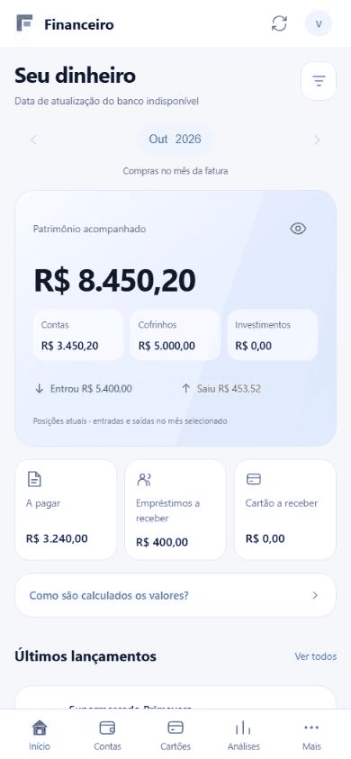
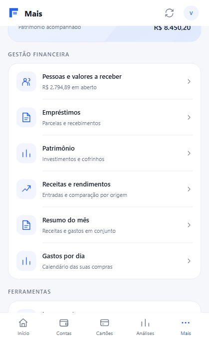
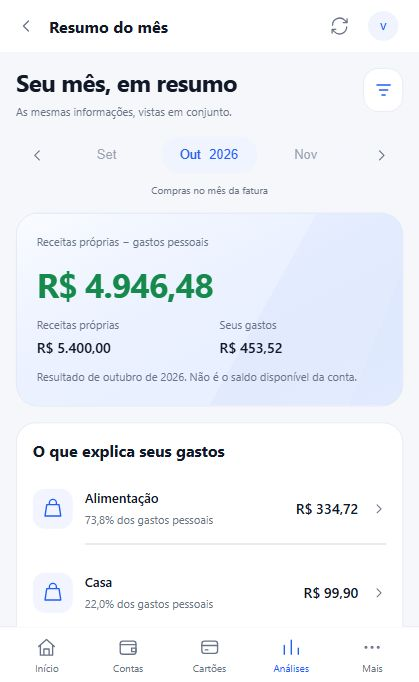
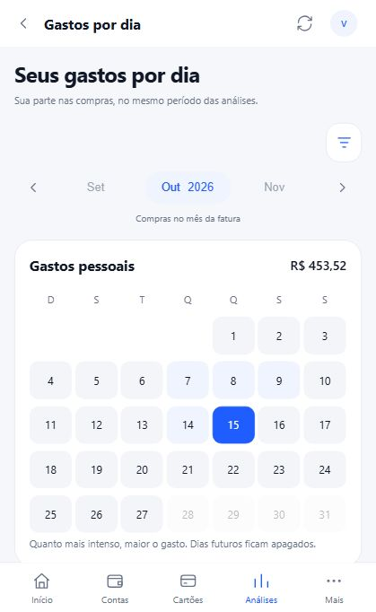
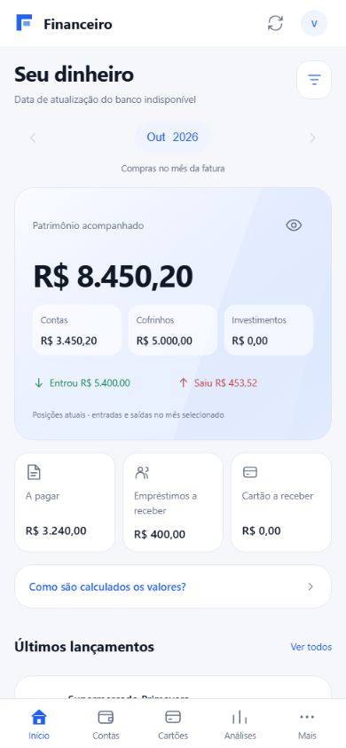
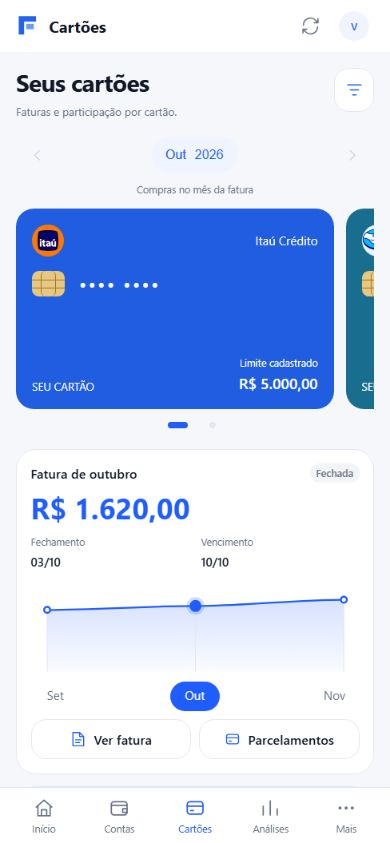
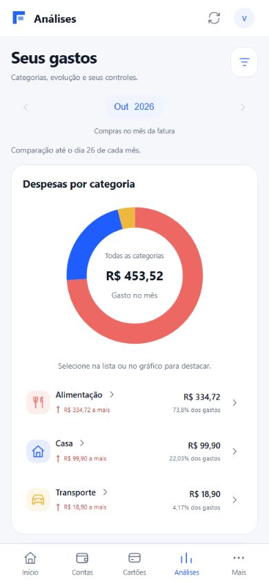
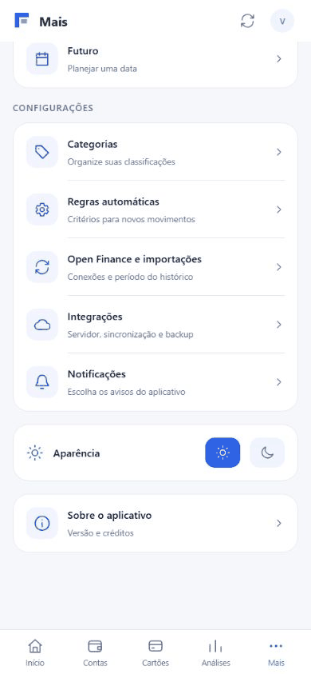
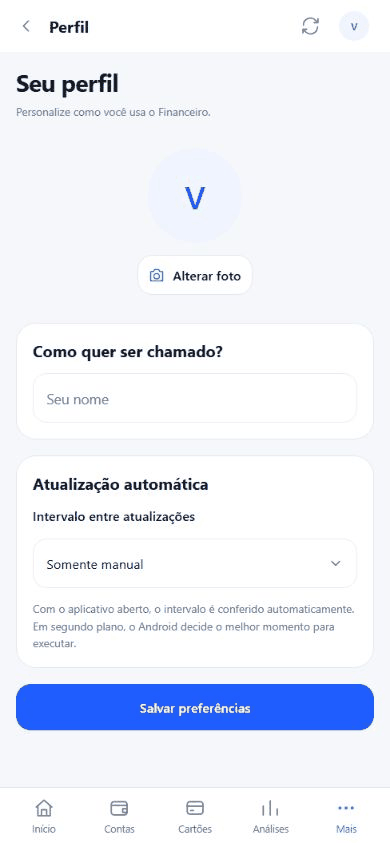
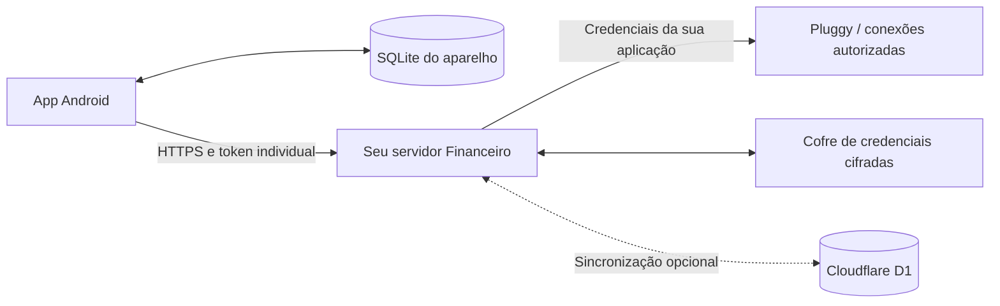

# Financeiro

**Organização financeira pessoal, do saldo de hoje às parcelas dos próximos meses.**

Aplicativo Android desenvolvido em React Native e TypeScript, com SQLite no aparelho, integração Open Finance via Pluggy e servidor configurável. Reúne contas, cartões, compras compartilhadas, empréstimos, receitas, reservas e análises por categoria.

<p align="center"></p>

> Demonstração no tema claro com dados fictícios na prévia web em formato de celular. O GIF reúne telas capturadas, sem operações bancárias reais. O visual no Android pode variar ligeiramente.

**[Galeria completa](docs/funcionalidades.md)** · **[Tema claro](docs/funcionalidades-claro.md)** · **[Tema escuro](docs/funcionalidades-escuro.md)** · **[Guia completo do servidor próprio](docs/servidor-proprio.md)** · **[Aplicativo Android](mobile/README.md)** · **[Backend](backend/README.md)**

## Atualizações do aplicativo

Baixe o APK em [Releases](https://github.com/Rogeriocsantana/MeuFinanceiro/releases). A partir da versão 0.3.38, o aplicativo avisa no topo quando houver uma versão mais nova. Consulte o [guia de atualizações](docs/atualizacoes.md).

**Correção do atualizador:** quem instalou 0.3.38 ou 0.3.39 deve instalar manualmente a [versão 0.3.40](https://github.com/Rogeriocsantana/MeuFinanceiro/releases/tag/v0.3.40), por cima da atual. Ela corrige a consulta no Android e acrescenta a verificação manual em Mais → Sobre o aplicativo. As próximas versões podem ser encontradas pelo atualizador corrigido.

### Atualizar sem procurar outro APK

Quando uma nova versão está disponível, aparece uma faixa no topo com a versão e o tamanho do download. Toque em **ⓘ** para ler as novidades ou em **Atualizar** para baixar. Na primeira vez, o Android pode pedir permissão para instalar atualizações desta origem; depois, volte ao app e toque em Atualizar novamente. A instalação sempre passa pela confirmação do Android.

<p align="center"></p>

> Captura demonstrativa da prévia web, com dados fictícios e a faixa simulando uma atualização disponível. O download e a instalação são recursos do Android. O app verifica integridade e assinatura antes de abrir o instalador.

Após instalar a correção 0.3.40, encerre e reabra o aplicativo quando uma versão superior for publicada. A faixa deve oferecer a nova versão. Instale por cima da versão atual, sem desinstalar. Ao concluir, abra **Mais → Gestão financeira** e confira **Resumo do mês** e **Gastos por dia** na nova posição. Versões iguais ou anteriores não geram aviso. Enquanto o aplicativo continua aberto, novas consultas têm um intervalo mínimo de um minuto.

## Novas formas de acompanhar o mês

As novas telas usam as informações e classificações já existentes, com acesso aos detalhes. A comparação por categorias continua em **Análises**.

| Função | Onde encontrar | Como usar |
| --- | --- | --- |
| Resumo do mês | Mais → Gestão financeira | Consulte receitas próprias, gastos pessoais e resultado do período. Toque nas categorias para abrir seus movimentos e use o acesso à comparação de categorias. O resultado do mês não é o saldo disponível em conta. |
| Gastos por dia | Mais → Gestão financeira | Veja o calendário com intensidade proporcional ao gasto e toque em um dia para consultar os lançamentos. Compare as médias de dias úteis e fins de semana. Dias futuros ficam apagados. |
| Controles e alertas | Início → Seus controles; Mais → Configurações → Alertas dos controles | Use o botão + para escolher uma categoria ainda sem controle, informe o limite e ative ou desative os avisos. Toque em um controle para editar ou excluir. |
| Novos lançamentos | Início → Para acompanhar | Abra os movimentos identificados nas importações recentes para revisar seus detalhes e classificações. |
| Contas recorrentes | Mais → Ferramentas | Cadastre compromissos fixos ou variáveis e vincule os lançamentos correspondentes, como uma conta de luz cujo valor muda a cada mês. |
| Atualização do app | Faixa no topo, quando houver uma nova Release | Consulte as novidades, baixe o APK e confirme a instalação no Android. Isso atualiza o aplicativo; a sincronização bancária continua com suas próprias configurações. |

<table>
<tr><th>Menu organizado</th><th>Resumo do mês</th><th>Gastos por dia</th></tr>
<tr><td></td><td></td><td></td></tr>
</table>

> Capturas da prévia web em tema claro, com dados fictícios. Os atalhos foram acrescentados ao sistema existente; Aparência e Sobre continuam ao final do menu Mais.

## Por que este projeto existe

Todo mês, separar minhas compras das compras de amigos e familiares nas faturas exigia tempo e conferência manual. Além disso, eu precisava acompanhar empréstimos em planilhas e somar parcelas futuras para entender quanto ainda tinha disponível e o que já estava comprometido.

Também faltava uma resposta simples para perguntas como: quanto estou gastando com alimentação e delivery? Quanto cada pessoa ainda precisa me pagar? Quanto falta para quitar o cartão?

A primeira versão nasceu no Google Apps Script. O uso diário fez o projeto crescer até uma versão Android, com consulta local, notificações e uma experiência voltada ao celular. A integração bancária levou à criação de um servidor para intermediar o acesso à Pluggy. Cada pessoa pode configurar a própria estrutura, sem depender do servidor do autor.

## O que você pode acompanhar

| Área | Recursos |
| --- | --- |
| Visão geral | Patrimônio acompanhado, entradas, saídas, obrigações e últimos lançamentos |
| Contas | Saldos por conta, instituições e movimentações |
| Cartões | Faturas, fechamento, vencimento, parcelas e participação de cada pessoa |
| Compras compartilhadas | Divisão de valores, responsáveis, vencimentos e recebimentos vinculados |
| Empréstimos | Contratos, parcelas, juros, valores recebidos e saldo por pessoa |
| Análises | Despesas por categoria, evolução e limites mensais |
| Patrimônio | Reservas, cofrinhos e investimentos cadastrados |
| Planejamento | Consulta de compromissos e simulação para uma data futura |
| Organização | Categorias, regras, busca e filtros por pessoa e origem |
| Configuração | Servidor próprio, importação, sincronização opcional, perfil, tema e notificações |

O aplicativo diferencia compras, pagamentos de fatura, transferências e recebimentos para evitar tratar todos os movimentos bancários como novas despesas ou receitas. Previsões dependem dos dados e das classificações disponíveis; confira os valores oficiais da instituição.

## Algumas telas

<table>
<tr><th>Início</th><th>Cartões</th><th>Análises</th></tr>
<tr><td></td><td></td><td></td></tr>
</table>

<table>
<tr><th>Servidor próprio</th><th>Importações</th><th>Preferências</th></tr>
<tr><td></td><td></td><td></td></tr>
</table>

Na [galeria completa](docs/funcionalidades.md), cada área tem sua imagem, GIF, caminho de acesso e explicação. Inclui classificação e divisão de compras, filtros da fatura, planejamento, categorias, regras, temas e notificações.

## Como os dados circulam



- **SQLite:** consulta dos dados já importados, inclusive offline.
- **Servidor:** API autenticada, validação de conexões e comunicação com a Pluggy.
- **Cofre:** Workers KV ou diretório persistente no Node; guarda credenciais cifradas.
- **D1:** sincronização financeira remota opcional. Não é requisito para importar bancos.

A URL do servidor e o token são configurados no aplicativo. Conectar outra instituição não exige alterar o código quando a integração estiver disponível; logos e cores do catálogo são aplicados às instituições reconhecidas. Bancos fora do catálogo usam uma marca neutra.

## Usar com seu próprio servidor

Você precisa de uma implantação da **API deste projeto**, com HTTPS e token individual. Informar a URL de uma API qualquer não cria a integração.

| Opção | Onde executa | Credenciais | Sincronização remota |
| --- | --- | --- | --- |
| Cloudflare | Workers | Workers KV cifrado | D1 opcional |
| Servidor próprio | Node atrás de proxy HTTPS | Arquivos cifrados em volume persistente | Não há adaptadores PostgreSQL/MySQL incluídos |

O [guia de servidor próprio](docs/servidor-proprio.md) ensina:

1. Instalar o backend e criar sua configuração local.
2. Criar o cofre e gerar um usuário/token individual.
3. Publicar no Cloudflare ou executar no Node com HTTPS.
4. Validar o serviço e conectar o aplicativo.
5. Configurar suas credenciais e conexões Pluggy.
6. Importar o histórico e consultar os dados offline.
7. Habilitar D1, se desejar, e resolver os erros mais comuns.

**O projeto não inclui credenciais, conexões ou acesso ao servidor do autor.** A integração bancária depende da sua conta, do provedor e dos consentimentos necessários. Para uso pessoal, consulte o [guia oficial do MeuPluggy](https://docs.pluggy.ai/pt/docs/guides/meu-pluggy-personal-use); aplicações para terceiros seguem as condições de integração do provedor.

## Primeiro uso do aplicativo

1. Instale seu APK ou execute o projeto em um Android de desenvolvimento.
2. Em **Mais → Integrações**, configure a origem HTTPS do servidor e o token do seu usuário.
3. Conecte o servidor e configure Client ID, Client Secret e IDs dos Items da sua aplicação Pluggy.
4. Em **Mais → Open Finance e importações**, escolha o início do histórico e atualize os dados.
5. Confira as contas e faturas importadas. Cadastre pessoas e classifique os movimentos.
6. Nas compras compartilhadas, informe os valores de cada pessoa; ao receber, vincule a entrada aos itens pagos.
7. Ajuste avisos, tema e intervalo de atualização conforme seu uso.

O app importa conexões existentes. O consentimento e a criação da conexão ocorrem no fluxo autorizado do provedor, não por digitar a senha bancária no Financeiro.

## Executar o projeto

### Requisitos

- Node.js **22.13 ou superior**, pnpm e Git.
- Android: JDK 17 e Android SDK configurados.
- Para integração real: sua conta Pluggy e servidor HTTPS configurado.

### Aplicativo

```sh
cd mobile
pnpm install
pnpm typecheck
pnpm android
```

A pasta Android é gerada pelo Expo. Expo Go não inclui todos os módulos nativos deste projeto. Consulte [mobile/README.md](mobile/README.md) para gerar seu APK e preservar a chave de assinatura.

### Backend

```sh
cd backend
pnpm install
pnpm test
```

Depois, siga o [guia de implantação](docs/servidor-proprio.md). Não publique `wrangler.example.jsonc` com os IDs de exemplo: copie para `wrangler.jsonc`, use os recursos da sua conta e mantenha a configuração preenchida fora do Git.

## Testes e verificação de publicação

Na pasta `mobile`:

```sh
pnpm typecheck
node --test tests/*.test.cjs
```

Na pasta `backend`:

```sh
pnpm test
```

Na raiz, antes de enviar ao GitHub:

```sh
node scripts/check-publication.cjs
```

Os testes verificam regras financeiras, persistência, isolamento de usuários, autenticação e fluxos do projeto. Não substituem a validação em aparelho ou uma auditoria de produção.

## Estrutura do repositório

```text
mobile/
  src/             Interface, regras e persistência local
  assets/          Ícones e logos incorporados
  plugins/         Configuração e extensões nativas
  tests/           Testes com cenários de demonstração
  scripts/         Build e verificação do APK
backend/
  src/             API, integração, autenticação e adaptadores
  migrations/      Schema do D1 opcional
  test/            Testes do servidor
  scripts/         Provisionamento local de usuários
  wrangler.example.jsonc
scripts/
  check-publication.cjs
docs/
  servidor-proprio.md
  funcionalidades.md
  media/           Imagens e GIFs com dados fictícios
```

## Privacidade e limites atuais

- Não envie tokens, Client Secret, extratos, fotos pessoais ou chaves de assinatura para o GitHub.
- Variáveis `EXPO_PUBLIC_*` são públicas no bundle e não devem conter segredos.
- O `.gitignore` usa uma lista de inclusão; dados locais e evidências não fazem parte da publicação.
- O SQLite local não deve ser considerado um banco com criptografia completa em repouso.
- O backend Node requer armazenamento persistente e HTTPS; o app não configura a infraestrutura por você.
- D1 é o adaptador de sincronização remota implementado. Administração de familiares também depende dele nesta versão.
- O código de Google Drive está preservado, mas seu módulo nativo está desabilitado no fluxo atual.
- Notificações e execução em segundo plano dependem das permissões e do agendamento do Android.

Veja [SECURITY.md](SECURITY.md) antes de implantar ou compartilhar dados de diagnóstico.

## Créditos

Projeto pessoal de Rogério Santana. React Native, Expo, TypeScript e SQLite formam a base do aplicativo; Pluggy fornece a integração de dados bancários autorizados. O projeto não é um aplicativo oficial dos bancos exibidos.

Logos pertencem às respectivas instituições. Proveniência em [mobile/assets/banks/SOURCES.md](mobile/assets/banks/SOURCES.md). Não há licença de redistribuição definida nesta entrega.


### Conferência de vínculos do Open Finance

Quando o banco muda o identificador de uma compra e não há correspondência segura, a importação fica aguardando conferência. É possível manter o mesmo lançamento, preservando pagamentos e recebimentos, ou importar como outra compra. As decisões ficam salvas para as próximas atualizações. Veja o [passo a passo](docs/atualizacoes.md).


Ao concluir a atualização geral, o app apresenta um resumo separado do **Open Finance** e do **D1**, com o resultado real, horário de comunicação, fila pendente e conflitos. O D1 é tentado mesmo quando os vínculos bancários aguardam conferência.

