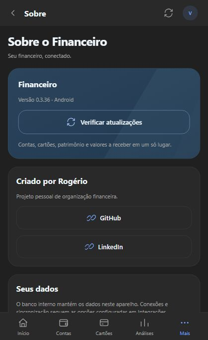
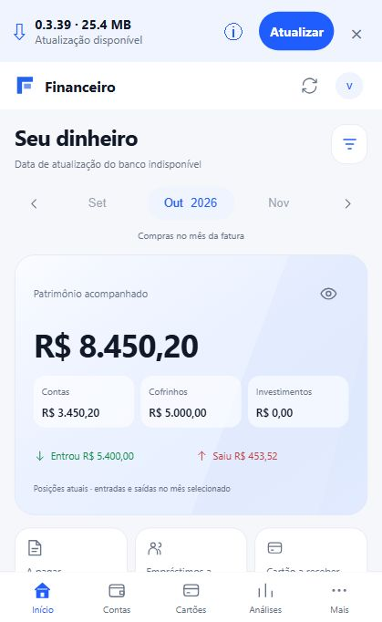

# Atualizações pelo GitHub

## Auditoria de animações na versão 0.3.60

Corrige a restauração tardia da rolagem, a entrada de painéis após carregar preferências, o fade de linhas nas expansões, a troca de opacidade dos meses, os nós de animação recriados durante edição e a ancoragem de seletores no Android. A barra de carregamento passa a acompanhar somente operações reais. Telas de resumo, controles, compras e configurações já começam com o snapshot local da conexão. O destaque do gráfico também passa a corresponder ao setor efetivamente tocado.

Mantém o layout e as funções existentes. Validação: TypeScript, 245 testes automatizados e percurso de 35 telas no emulador Android, com testes interativos de rolagem/volta, atualização, grupos, meses, painéis, teclado, filtros e gráficos. [Relatório e limites da validação](auditoria-movimento-0.3.60.md).


## Cartões opacos e troca coordenada na versão 0.3.59

A troca em Leque mantém as faces dos cartões opacas. Uma única animação nativa coordena o cartão que sai e a subida dos demais; a conclusão vem do retorno da animação, sem um temporizador independente para remover a camada. Isso elimina a animação de transparência do cartão reutilizado na pilha.

Os nós de transformação e os manipuladores de gesto permanecem estáveis durante renderizações com dados atualizados. Toques durante uma troca são ignorados até a conclusão; mudanças na lista cancelam a transição antiga. A redução de movimento do Android continua respeitada. O layout e as funções das telas são preservados.

Validação: TypeScript e 239 testes passaram, incluindo trocas repetidas, bloqueio de toques concorrentes, redução de movimento e alteração de cartões durante a transição. O componente real foi conferido no emulador Android com dados fictícios, temas claro/escuro e renderizações a cada 200 ms; foram capturados o meio e o fim da troca e testados gestos para os dois lados. Isso não substitui a confirmação no Poco físico. O cenário de teste não integra o APK público.


## Correção de abertura na versão 0.3.58

A versão 0.3.57 podia fechar imediatamente com **Cannot find native module ExpoAsset**. O pacote de compilação estava sem os arquivos Gradle de alguns módulos transitivos do Expo, que por isso não entraram na lista de módulos nativos. Os arquivos foram restaurados a partir das versões exatas das dependências locais.

A verificação do APK agora inspeciona a lista de módulos registrada no DEX e exige Asset, Application, Font, BackgroundTask, TaskManager, SecureStore, SQLite, SplashScreen e o agendador de notificações, além das verificações anteriores de assinatura, versão e permissões. A versão 0.3.57 foi retirada da oferta de atualização estável.

Se o aplicativo não abrir, baixe o APK da 0.3.58 pela página de Releases e instale **sobre a versão atual**, sem desinstalar nem limpar os dados. A assinatura e o identificador permanecem os mesmos. Essa correção mantém os ajustes de segundo plano da 0.3.57 e não modifica o banco de dados, recebimentos ou vínculos.


Validação de abertura: a variante release x86_64 foi instalada sobre a 0.3.57 no emulador, abriu a introdução e permaneceu ativa sem exceção de módulo nativo. O bundle JavaScript é idêntico ao do APK ARM64 publicado. O APK ARM64 passou na checagem de módulos registrados no DEX e assinatura original. Não foi feito teste no Poco físico nem acesso a dados bancários reais nesse teste.

## Atualização com o app fechado na versão 0.3.57

O agendamento do Android passa a verificar a cada **no mínimo 15 minutos**, enquanto a importação continua respeitando o intervalo salvo no Perfil. Uma tentativa que falha não precisa aguardar outro intervalo inteiro de 720 ou 1440 minutos para ser tentada novamente. A migração recria uma vez o agendamento antigo: o registro de uma tarefa já existente retornava sem atualizar seu agendamento nesta versão da biblioteca. Abrir o app depois da migração não reinicia o agendamento.

Com **Dados bancários atualizados** ativado em Notificações, uma tentativa concluída em segundo plano gera um aviso mesmo sem novos movimentos. O aviso separa **Open Finance** e **D1**. Falhas também geram um aviso, limitado a uma ocorrência por janela de seis horas para evitar repetição a cada tentativa. Lembretes e alertas são preparados mesmo se o Open Finance falhar ou houver vínculos aguardando conferência. Isso não altera quitações, recebimentos ou decisões de vínculo.

Em **Mais → Perfil → Diagnóstico deste aparelho**, confira o intervalo registrado, o resultado da execução e eventuais erros de preparação dos avisos. O botão **Permitir execução em segundo plano** abre as configurações do app. No Poco, confira **Bateria → Sem restrições** e a permissão de **Inicialização automática**, quando disponível.

Para testar, instale a versão, abra uma vez, salve temporariamente **15 minutos** no Perfil e ative **Dados bancários atualizados** em Notificações. Saia pelo botão Início e deixe o celular com rede, sem abrir o Financeiro nem tocar em Atualizar. Aguarde a execução e confira o aviso; depois consulte o diagnóstico. Reponha seu intervalo habitual após o teste. A execução real no Poco ainda precisa desse teste: os testes automatizados não provam o comportamento do fabricante.

O Android controla o horário e pode adiar o trabalho por bateria ou rede. **Forçar parada** impede a execução até reabrir o app. O app consulta os dados disponíveis na integração; não obriga o banco a disponibilizar compras recentes.

Validação: 237 testes aprovados e TypeScript sem erros, incluindo execução sem tela montada, aviso sem novos movimentos, falha com D1 independente, migração do agendamento e deduplicação dos avisos.


## Recuperação de requisições e diagnóstico na versão 0.3.49

O limite de 25 segundos agora cobre a requisição inteira, inclusive a leitura do corpo JSON. Antes, o temporizador era encerrado ao receber os cabeçalhos: uma resposta incompleta poderia manter a sincronização pendente. O limite também retorna erro quando a implementação nativa não encerra a promessa após o pedido de cancelamento.

A tarefa em segundo plano registra as etapas **verificando intervalo**, **consultando Open Finance**, **sincronizando D1** e **preparando notificações**. O Perfil mostra a última etapa registrada. Um registro sem conclusão por mais de dez minutos aparece como **sem conclusão registrada; pode ter sido interrompida**, sem presumir sucesso ou afirmar a causa da interrupção.

Uma tentativa sem conclusão não reinicia o intervalo configurado: o cálculo considera a última atualização concluída e permite nova tentativa após o intervalo curto de proteção. O Android continua controlando quando executa o trabalho em segundo plano. A versão anterior não tinha registro de etapas suficiente para identificar o ponto de uma interrupção já ocorrida.

Validação: 219 testes aprovados e TypeScript sem erros, incluindo resposta JSON que não termina, fetch que não respeita cancelamento, nova tentativa e cenário de intervalo de 720 minutos vencido.

## Segundo plano e notificações na versão 0.3.48

O agendamento só é configurado depois de carregar as preferências da conexão ativa. Isso evita cancelar a tarefa com o valor manual padrão durante a abertura do app. Avisos imediatos usam o canal financeiro explicitamente; se o Android recusar um agendamento, o registro de deduplicação é liberado para permitir nova tentativa.

Em **Mais → Perfil**, o diagnóstico informa se a tarefa está registrada e a última execução efetiva em segundo plano registrada nesta versão (concluída, intervalo ainda não vencido ou falha). Abrir o app para atualizar não conta como uma execução em segundo plano. Esse diagnóstico fica somente neste aparelho.

Em **Mais → Notificações**, use **Enviar notificação de teste** e **Atualizar diagnóstico** para conferir a permissão do Android, o canal de avisos e a quantidade de lembretes agendados. O teste pede permissão se necessário, mas não altera as preferências salvas de avisos financeiros. Uma atualização bloqueada por vínculos não produz aviso de dados bancários atualizados.

Para testar: salve um intervalo no Perfil, ative e salve os tipos desejados em Notificações, envie o teste e deixe o aplicativo em segundo plano. Depois confira o horário da execução no diagnóstico. O Android controla quando a tarefa roda e pode adiá-la por bateria, rede ou restrições do fabricante; não é um horário garantido. Forçar a parada bloqueia a execução até reabrir o app.

Validação: 214 testes aprovados e TypeScript sem erros. Inclui nova tentativa de notificação após falha e registro de sucesso/falha da tarefa sem tela montada. A execução real no celular depende do teste no aparelho.

## Resultado separado na versão 0.3.47

Ao terminar a atualização geral, o painel **Resultado da atualização** apresenta duas seções:

- **Open Finance:** registros atualizados ou o motivo da interrupção, incluindo vínculos aguardando conferência.
- **D1:** sincronizado, com pendências, desativado, não configurado ou falha. Uma comunicação concluída mostra o horário, as operações aguardando envio e os conflitos da conta sincronizada.

O D1 só aparece como sincronizado quando a passagem concluiu e a fila e os conflitos estão zerados. A atualização geral aguarda uma passagem remota anterior e inicia uma nova para incluir alterações recentes. Edições feitas durante o envio são capturadas entre os lotes, reduzindo a necessidade de uma segunda atualização manual. Em caso de limite de lotes ou alterações ainda pendentes, o painel indica pendências para conferir em Integrações.

Para testar com vínculos pendentes, mantenha-os aguardando, use a atualização geral e confira as duas seções do painel. A importação bloqueada não impede a tentativa remota e nenhuma quitação é transferida sem sua decisão.

## Sincronizações independentes na versão 0.3.46

A atualização geral e a atualização automática tentam sincronizar o banco remoto D1 mesmo se o Open Finance falhar ou aguardar conferência de vínculos. A sincronização remota precisa estar ativada em Integrações e depende de acesso ao servidor.

Os resultados são independentes: uma falha bancária continua indicada e pode ser tentada novamente; uma falha no D1 mantém a fila pendente. Nenhum vínculo duvidoso é aprovado automaticamente para permitir a sincronização.

## Vínculos para conferir na versão 0.3.45

Em **Mais → Open Finance / Importações → Vínculos para conferir**, revise compras cuja identidade mudou sem uma referência segura do banco. Se uma importação já foi bloqueada na versão anterior, atualize os dados novamente para carregar os itens para conferência.

- **É o mesmo lançamento:** selecione o registro salvo. O aplicativo mantém a identidade local, as participações, a quitação e os recebimentos vinculados, e passa a reconhecer o novo identificador externo.
- **É outra compra:** o lançamento recebido fica separado. Nenhum pagamento da compra anterior é transferido para ele.

Salve a decisão de cada item e toque em **Concluir importação**. As decisões parciais ficam salvas mesmo ao fechar o aplicativo; a importação só é aplicada quando todos os itens estiverem conferidos. Depois de concluída, repetir os mesmos identificadores não exige nova conferência. Uma nova mudança de identidade sem referência segura pode exigir outra revisão.

Se os dados financeiros mudarem durante a conferência, a conclusão é recusada para preservar os vínculos. Atualize a importação e confira novamente com os dados atuais. Alterações de valor e outros campos continuam passando pela revisão de alterações existente.

Validação: 194 testes automatizados, incluindo persistência das decisões, importações repetidas, compras separadas, preservação de recebimentos e rollback em falha de gravação.


## Proteção de vínculos na versão 0.3.44

Nas próximas importações, os identificadores internos usados nas participações e recebimentos permanecem estáveis. Se a referência estável do banco confirmar a identidade, um novo identificador externo é registrado como alias, preservando a quitação.

Valor, descrição e data semelhantes não autorizam transferir pagamentos. Ao detectar possível troca de identificador sem referência segura, a importação é cancelada por inteiro e mostra uma mensagem para conferência. Os dados salvos, quitações, recebimentos e a fila de sincronização permanecem como estavam. Isso pode exigir conferência também para compras legitimamente parecidas; a proteção prioriza não aplicar uma quitação à compra errada.

## Vencimentos na versão 0.3.43

O dia-base do cartão fica salvo e pode ser editado. Sem configuração anterior, o aplicativo usa o dia recorrente do histórico; sem histórico suficiente, inicia com dia 10. Uma fatura excepcional não muda esse dia-base. Para os cartões Itaú e Mercado Pago desta configuração, o dia-base é 10.

Quando não há uma data oficial para o mês, a previsão avança sábados e domingos para segunda-feira. O aplicativo não presume feriados: quando a instituição enviar o vencimento específico pelo Open Finance, essa data prevalece sobre a previsão. A mesma regra acompanha as parcelas importadas, participações e projeções futuras, preservando valores e vínculos.

## Correção necessária nas versões 0.3.38 e 0.3.39

Essas versões usavam uma função de tempo limite indisponível no ambiente React Native do Android. A consulta falhava antes de acessar o GitHub. Instale manualmente a versão 0.3.40 por cima da atual, sem desinstalar; ela corrige a consulta e permite testar as próximas Releases pelo próprio app.

Em Mais → Sobre o aplicativo, use **Verificar atualização do aplicativo**. A consulta manual informa se existe atualização, se a versão já é a mais recente ou se houve falha de conexão. O aviso automático continua no topo quando há uma versão mais nova.

Na versão 0.3.41, o botão ganhou contorno e fundo transparente para acompanhar o cartão também no tema escuro. O filtro do Resumo do mês e das outras telas novas foi alinhado ao cabeçalho, como nas demais páginas.



Captura demonstrativa da prévia web; a versão exibida na imagem é a da prévia, não a versão do APK publicado.



Captura da prévia web com dados fictícios e aviso demonstrativo. No Android, a faixa consulta as Releases reais.

## Teste após instalar a correção

1. Instale manualmente a versão 0.3.40 corrigida. Quando uma versão superior for publicada, mantenha essa instalação para testar o aviso.
2. Encerre e reabra o aplicativo para consultar a última Release.
3. Confira a versão mais nova, tamanho e novidades na faixa superior. Se estiver na última versão, use Mais → Sobre → Verificar atualização do aplicativo para conferir o resultado.
4. Toque em Atualizar. Se o Android pedir permissão para instalar desta origem, autorize, volte e toque novamente.
5. Confirme a instalação e abra o app.
6. Verifique em Mais que Resumo do mês e Gastos por dia estão em Gestão financeira. Seus dados devem permanecer.

Se o app já estava aberto durante a publicação, a consulta em segundo plano respeita o intervalo de um minuto. Encerrar e reabrir inicia uma nova consulta. O botão de atualizar dados bancários é independente da atualização do APK.

O Android consulta a última Release estável de `Rogeriocsantana/MeuFinanceiro` ao abrir e ao retornar ao app, com intervalo mínimo de um minuto. Uma faixa no topo mostra versão, tamanho, novidades e a ação Atualizar. Dispensar a faixa vale apenas para a sessão.

Cada Release deve conter o APK assinado e `update.json`:

```json
{
  "packageName": "com.roger.financeiro",
  "version": "0.3.39",
  "versionCode": 40,
  "apkAssetName": "financeiro-0.3.39-arm64-v8a.apk",
  "size": 12345678,
  "sha256": "SHA256_DO_APK_COM_64_CARACTERES_HEXADECIMAIS"
}
```

Use o tamanho real em bytes e o SHA-256 calculado sobre o APK final. Aumente `versionCode` a cada atualização. O aplicativo ignora rascunhos, pré-lançamentos e versões iguais ou anteriores. Escreva as novidades na descrição da Release.

O download verifica tamanho, SHA-256, pacote, versão e assinatura original. O Android pede autorização para instalar aplicativos desta origem e confirma a instalação. Os dados permanecem no aparelho ao atualizar com o mesmo pacote e chave. Não desinstale o aplicativo para atualizar.

Guarde a chave de assinatura e suas senhas fora do Git. APK e manifesto são anexos da Release, não arquivos para adicionar ao código-fonte. O acesso público às Releases não exige tokens dentro do app.

Para testar: instale a versão inicial com atualizador; publique depois uma Release estável com um versionCode maior. Reabra o aplicativo e toque em Atualizar. A versão inicial não deve anunciar a si mesma como atualização.


