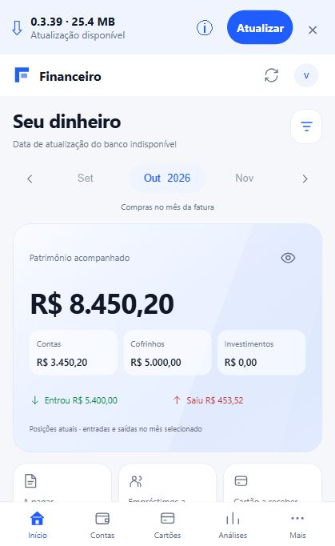

# Atualizações pelo GitHub



Captura da prévia web com dados fictícios e aviso demonstrativo. No Android, a faixa consulta as Releases reais.

## Teste da versão 0.3.39

1. Mantenha a versão 0.3.38 instalada. Não é necessário baixar o APK seguinte pelo navegador.
2. Encerre e reabra o aplicativo para consultar a última Release.
3. Confira versão 0.3.39, tamanho e novidades na faixa superior.
4. Toque em Atualizar. Se o Android pedir permissão para instalar desta origem, autorize, volte e toque novamente.
5. Confirme a instalação e abra o app.
6. Verifique em Mais que Resumo do mês e Gastos por dia estão em Gestão financeira. Seus dados devem permanecer.

Se o app já estava aberto durante a publicação, a consulta em segundo plano respeita o intervalo de uma hora. Encerrar e reabrir inicia uma nova consulta. O botão de atualizar dados bancários é independente da atualização do APK.

O Android consulta a última Release estável de `Rogeriocsantana/MeuFinanceiro` ao abrir e ao retornar ao app, com intervalo mínimo de uma hora. Uma faixa no topo mostra versão, tamanho, novidades e a ação Atualizar. Dispensar a faixa vale apenas para a sessão.

Cada Release deve conter o APK assinado e `update.json`:

```json
{
  "packageName": "com.roger.financeiro",
  "version": "0.3.39",
  "versionCode": 40,
  "apkAssetName": "financeiro-0.3.39-arm64-v8a.apk",
  "size": 12345678,
  "sha256": "SHA256_DO_APK_COM_64_CARACTERES_HEXADECIMAIS"
}
```

Use o tamanho real em bytes e o SHA-256 calculado sobre o APK final. Aumente `versionCode` a cada atualização. O aplicativo ignora rascunhos, pré-lançamentos e versões iguais ou anteriores. Escreva as novidades na descrição da Release.

O download verifica tamanho, SHA-256, pacote, versão e assinatura original. O Android pede autorização para instalar aplicativos desta origem e confirma a instalação. Os dados permanecem no aparelho ao atualizar com o mesmo pacote e chave. Não desinstale o aplicativo para atualizar.

Guarde a chave de assinatura e suas senhas fora do Git. APK e manifesto são anexos da Release, não arquivos para adicionar ao código-fonte. O acesso público às Releases não exige tokens dentro do app.

Para testar: instale a versão inicial com atualizador; publique depois uma Release estável com um versionCode maior. Reabra o aplicativo e toque em Atualizar. A versão inicial não deve anunciar a si mesma como atualização.
