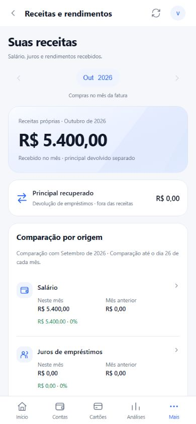
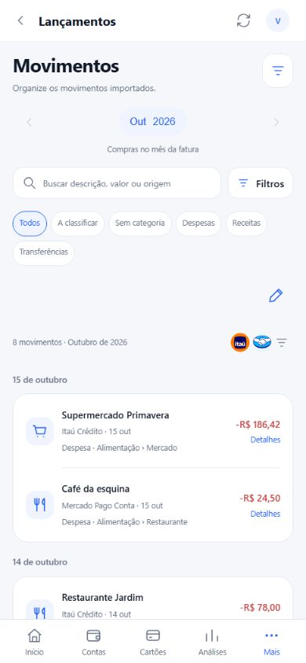
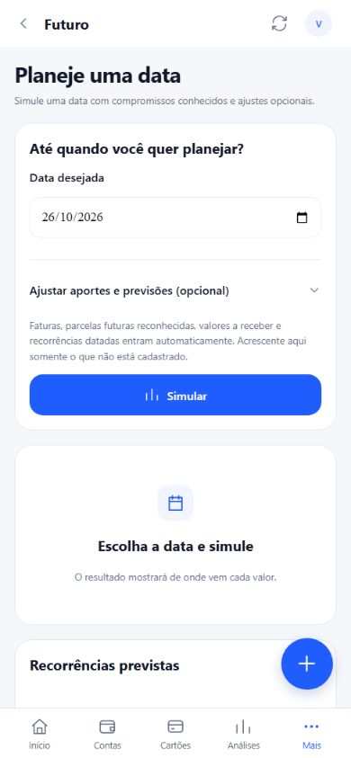
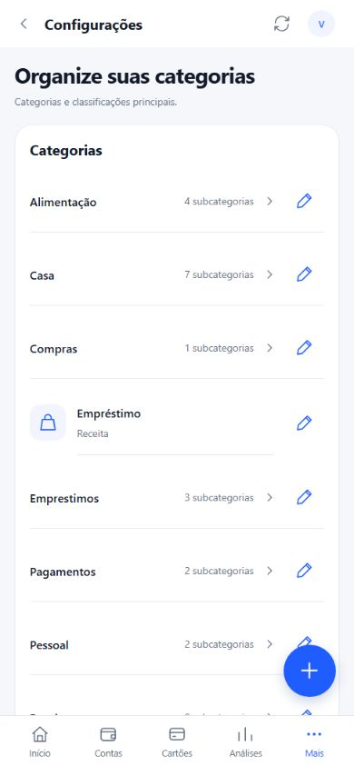

# Galeria de funcionalidades — tema claro

**[Tema claro](funcionalidades-claro.md) · [Tema escuro](funcionalidades-escuro.md) · [Escolher tema](funcionalidades.md)**

Capturas da interface real do projeto, executada na prévia web em formato de celular (390 × 844), com dados fictícios. Não são capturas de uma conta bancária real nem comprovam conexão de produção. O visual nativo pode apresentar pequenas diferenças.

Os GIFs são sequências curtas de telas capturadas: mostram o menu de acesso, a área, a rolagem ou a opção indicada. Não são gravações contínuas e não demonstram operações bancárias.

[Voltar ao README](../README.md) · [Configurar servidor próprio](servidor-proprio.md)

- [Visão geral](#inicio)
- [Contas](#contas)
- [Cartões](#cartoes)
- [Detalhes da fatura](#fatura)
- [Análises](#analises)
- [Pessoas e valores a receber](#pessoas)
- [Empréstimos](#emprestimos)
- [Patrimônio](#patrimonio)
- [Receitas e rendimentos](#receitas)
- [Lançamentos](#lancamentos)
- [Classificação e despesas compartilhadas](#classificacao)
- [Parcelamentos](#parcelamentos)
- [Planejamento futuro](#futuro)
- [Categorias](#categorias)
- [Regras automáticas](#regras)
- [Servidor e sincronização](#integracoes)
- [Open Finance e importações](#importacoes)
- [Notificações](#notificacoes)
- [Perfil e atualização automática](#perfil)
- [Aparência](#aparencia)

## Visão geral

Patrimônio acompanhado, entradas e saídas, obrigações e últimos lançamentos.

**Acesso:** Início.

<table><tr><th>Imagem demonstrativa</th><th>GIF da área/opção</th></tr><tr><td></td><td></td></tr></table>

## Contas

Saldos das contas, posições em cofrinhos e resumo das movimentações.

**Acesso:** Contas.

<table><tr><th>Imagem demonstrativa</th><th>GIF da área/opção</th></tr><tr><td></td><td></td></tr></table>

## Cartões

Cartões por instituição, fatura do mês, fechamento, vencimento e participação de cada pessoa.

**Acesso:** Cartões.

<table><tr><th>Imagem demonstrativa</th><th>GIF da área/opção</th></tr><tr><td></td><td></td></tr></table>

## Detalhes da fatura

Movimentos por data, parcelas e filtro entre Todos, Você e pessoas com participação no período. O GIF mostra a aplicação do filtro Você.

**Acesso:** Cartões → Ver fatura.

<table><tr><th>Imagem demonstrativa</th><th>GIF da área/opção</th></tr><tr><td></td><td></td></tr></table>

## Análises

Gastos pessoais por categoria, evolução mensal e limites de gastos.

**Acesso:** Análises.

<table><tr><th>Imagem demonstrativa</th><th>GIF da área/opção</th></tr><tr><td></td><td></td></tr></table>

## Pessoas e valores a receber

Compras e empréstimos agrupados por pessoa, com seus saldos e acesso ao perfil.

**Acesso:** Mais → Pessoas e valores a receber.

<table><tr><th>Imagem demonstrativa</th><th>GIF da área/opção</th></tr><tr><td></td><td></td></tr></table>

## Empréstimos

Total pendente, recebimentos por mês, parcelas em atraso e agrupamento por pessoa.

**Acesso:** Mais → Empréstimos.

<table><tr><th>Imagem demonstrativa</th><th>GIF da área/opção</th></tr><tr><td></td><td></td></tr></table>

## Patrimônio

Contas, investimentos, reservas e cofrinhos em uma visão consolidada.

**Acesso:** Mais → Patrimônio.

<table><tr><th>Imagem demonstrativa</th><th>GIF da área/opção</th></tr><tr><td></td><td></td></tr></table>

## Receitas e rendimentos

Receitas próprias por origem; principal recuperado separado de receita.

**Acesso:** Mais → Receitas e rendimentos.

<table><tr><th>Imagem demonstrativa</th><th>GIF da área/opção</th></tr><tr><td></td><td></td></tr></table>

## Lançamentos

Busca, filtros de categoria e natureza, origens bancárias e seleção para classificação.

**Acesso:** Mais → Lançamentos.

<table><tr><th>Imagem demonstrativa</th><th>GIF da área/opção</th></tr><tr><td></td><td></td></tr></table>

## Classificação e despesas compartilhadas

Detalhes de uma parcela e formulário com natureza, categoria, divisão por pessoa e vencimento. O GIF abre o painel sem gravar mudanças.

**Acesso:** Lançamentos → Detalhes → Classificar lançamento.

<table><tr><th>Imagem demonstrativa</th><th>GIF da área/opção</th></tr><tr><td></td><td></td></tr></table>

## Parcelamentos

Compras parceladas dos cartões, número de parcelas e responsáveis.

**Acesso:** Mais → Parcelamentos.

<table><tr><th>Imagem demonstrativa</th><th>GIF da área/opção</th></tr><tr><td></td><td></td></tr></table>

## Planejamento futuro

Escolha de data e aporte para simulação com os dados já cadastrados. Previsões dependem dos lançamentos disponíveis.

**Acesso:** Mais → Futuro.

<table><tr><th>Imagem demonstrativa</th><th>GIF da área/opção</th></tr><tr><td></td><td></td></tr></table>

## Categorias

Organização das categorias e subcategorias usadas na classificação e nas análises.

**Acesso:** Mais → Categorias.

<table><tr><th>Imagem demonstrativa</th><th>GIF da área/opção</th></tr><tr><td></td><td></td></tr></table>

## Regras automáticas

Critérios para classificar movimentos e aplicar regras aos lançamentos compatíveis.

**Acesso:** Mais → Regras automáticas.

<table><tr><th>Imagem demonstrativa</th><th>GIF da área/opção</th></tr><tr><td></td><td></td></tr></table>

## Servidor e sincronização

URL HTTPS, token individual, importação de arquivo de conexão, disponibilidade do cofre Pluggy e sincronização remota opcional. O exemplo permanece desconectado.

**Acesso:** Mais → Integrações.

<table><tr><th>Imagem demonstrativa</th><th>GIF da área/opção</th></tr><tr><td></td><td></td></tr></table>

## Open Finance e importações

Consulta das conexões, período inicial do histórico e atualização dos dados bancários. Nenhuma conexão real foi consultada nas capturas.

**Acesso:** Mais → Open Finance e importações.

<table><tr><th>Imagem demonstrativa</th><th>GIF da área/opção</th></tr><tr><td></td><td></td></tr></table>

## Notificações

Preferências de avisos para faturas, empréstimos e atualizações. A entrega das notificações depende do Android e das permissões do aparelho.

**Acesso:** Mais → Notificações.

<table><tr><th>Imagem demonstrativa</th><th>GIF da área/opção</th></tr><tr><td></td><td></td></tr></table>

## Perfil e atualização automática

Nome, foto e intervalo de atualização. O GIF abre as opções de intervalo, sem salvar mudanças.

**Acesso:** Ícone do perfil no cabeçalho.

<table><tr><th>Imagem demonstrativa</th><th>GIF da área/opção</th></tr><tr><td></td><td></td></tr></table>

## Aparência

Opções de aparência no menu do aplicativo, apresentadas com o tema claro selecionado.

**Acesso:** Mais → Aparência.

<table><tr><th>Imagem demonstrativa</th><th>GIF da área/opção</th></tr><tr><td></td><td></td></tr></table>

